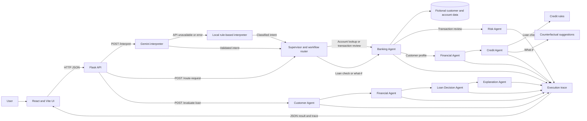

# Glass Box Loan Desk

A simulated banking assistant that accepts natural-language requests, routes them
through a multi-agent pipeline, and returns explainable results with a full
agent execution trace.

> **Demonstration only.** All customer data is fictional. No real banking
> transactions or lending decisions are made.

---

## Project objectives

- Accept plain-English banking requests and interpret them using Google Gemini,
  with an automatic rule-based fallback when the API is unavailable.
- Route each request through specialist agents using a Supervisor Agent.
- Return transparent, rule-by-rule explanations for every decision.
- Show the complete agent execution trace — inputs, outputs, timing — in the UI.

---

## Architecture



The assistant and workbench send requests through the supervisor, which selects
specialist agents for the requested workflow. The loan application form uses a
separate customer-validation and decision pipeline. All workflows return JSON;
agent steps record their inputs, outputs, status, and duration for display in
the UI. All customer and account data is simulated.

See the [architecture guide](docs/architecture.md) for a detailed diagram,
request flows, and component responsibilities.

---

## The four workflows

| Workflow | Trigger phrase examples | Agents used |
|---|---|---|
| `account_lookup` | "Show account for CUST-1001", "balance of CUST-1002" | Banking Agent |
| `suspicious_txn` | "Review transactions for CUST-1001", "suspicious activity" | Banking Agent → Risk Agent |
| `loan_check` | "Can CUST-1003 get a ₹200000 loan?", "loan eligibility" | Banking Agent → Financial Agent → Credit Agent |
| `what_if` | "What would CUST-1003 need to improve?", "what if" | Banking Agent → Financial Agent → Credit Agent |

---

## Technology stack

| Layer | Technology |
|---|---|
| Frontend | React 19, Vite 8 |
| Backend | Python 3.14, Flask 3, flask-cors |
| NL interpretation | Google Gemini API (`gemini-2.0-flash` or `gemini-3.6-flash`) with local fallback |
| Testing | pytest |
| Environment | python-dotenv |

---

## Project structure

```
glass-box-loan-desk/
├── backend/
│   ├── app/
│   │   ├── agents/
│   │   │   ├── banking_agent.py          fetch profile, balance, transactions
│   │   │   ├── credit_agent.py           credit rules + what-if suggestions
│   │   │   ├── customer_agent.py         validate applicant input
│   │   │   ├── explanation_agent.py      format final result
│   │   │   ├── financial_agent.py        DTI and loan-to-income ratios
│   │   │   ├── gemini_interpreter.py     Gemini + local fallback interpreter
│   │   │   ├── loan_decision_agent.py    apply decision rules
│   │   │   ├── risk_agent.py             flag high-value transactions
│   │   │   └── supervisor_agent.py       route request types to agents
│   │   ├── data/
│   │   │   └── mock_data.py              fictional customers, balances, transactions
│   │   └── tools/
│   │       ├── customer_tools.py         get_profile, get_balance, get_transactions, assess_health
│   │       └── execution_trace.py        wrap agent calls with input/output/timing
│   ├── tests/
│   │   ├── test_agents.py                16 tests — financial, credit, risk, supervisor
│   │   ├── test_customer_tools.py        9 tests  — profile, balance, transactions
│   │   ├── test_endpoints.py             19 tests — all three Flask endpoints
│   │   └── test_interpreter.py           10 tests — local interpreter
│   ├── .env                              GEMINI_API_KEY (not committed)
│   └── server.py                         Flask app — all three endpoints
├── frontend/
│   ├── src/
│   │   ├── App.jsx                       three panels + AgentTrace + JsonPanel
│   │   ├── App.css                       styles
│   │   └── main.jsx                      React entry point
│   ├── package.json
│   └── vite.config.js                    pinned to port 5173
└── README.md
```

---

## Prerequisites

- Python 3.11 or later
- Node.js 18 or later and npm
- A Google Gemini API key (optional — the local fallback works without it)

---

## Installation

### Backend

```powershell
cd glass-box-loan-desk\backend
python -m venv .venv
.venv\Scripts\activate
pip install flask flask-cors python-dotenv google-genai pytest
```

### Frontend

```powershell
cd glass-box-loan-desk\frontend
npm install
```

---

## Gemini API configuration

Create `backend/.env` with your API key:

```
GEMINI_API_KEY=your_api_key_here
```

The backend reads this with `python-dotenv`. If the key is missing or Gemini
returns an error, every request automatically falls back to the local
rule-based interpreter. The application is fully functional without a working
Gemini key.

**Never commit `.env` to version control.**

---

## Starting the application

Open two terminals.

**Terminal 1 — Flask backend:**

```powershell
cd glass-box-loan-desk\backend
.venv\Scripts\activate
python server.py
```

Expected output:
```
* Running on http://127.0.0.1:5000
```

**Terminal 2 — React frontend:**

```powershell
cd glass-box-loan-desk\frontend
npm run dev
```

Expected output:
```
  Local:   http://localhost:5173/
```

Open `http://localhost:5173` in your browser.

---

## API endpoints

### `GET /`
Health check.

```json
{ "status": "success", "message": "Glass Box Loan Desk backend is running!" }
```

---

### `POST /interpret`
Natural-language entry point. Interprets a plain-English message and runs the
matching workflow.

**Request:**
```json
{ "message": "Check loan eligibility for CUST-1001 for 200000" }
```

**Response (success):**
```json
{
  "request_type": "loan_check",
  "interpreted_as": { "request_type": "loan_check", "customer_id": "CUST-1001", "loan_amount": 200000 },
  "credit_result": { "decision": "Eligible for Consideration", "rules_checked": [...] },
  "agent_trace": [...]
}
```

**Response (clarification needed):**
```json
{
  "needs_clarification": true,
  "clarification": "Which customer ID should I use? (CUST-1001, CUST-1002, or CUST-1003)"
}
```

---

### `POST /route-request`
Structured workflow entry point used by the Supervisor Agent Workbench.

**Request:**
```json
{ "request_type": "account_lookup", "customer_id": "CUST-1001" }
```

```json
{ "request_type": "loan_check", "customer_id": "CUST-1002", "loan_amount": 300000 }
```

---

### `POST /evaluate-loan`
Standalone loan application form.

**Request:**
```json
{
  "name": "Aarav Sharma",
  "monthlyIncome": 65000,
  "loanAmount": 200000,
  "monthlyDebt": 8000,
  "employmentType": "Salaried",
  "creditScore": 760
}
```

---

## Simulated customers

| ID | Name | Income | Credit score | EMI |
|---|---|---|---|---|
| CUST-1001 | Aarav Sharma | ₹65,000 | 760 | ₹8,000 |
| CUST-1002 | Meera Iyer | ₹42,000 | 680 | ₹12,000 |
| CUST-1003 | Kabir Rao | ₹28,000 | 610 | ₹2,000 |

---

## Credit rules

| Rule | Threshold |
|---|---|
| Minimum credit score | ≥ 650 |
| Maximum debt-to-income ratio | ≤ 40% |
| Maximum loan-to-monthly-income ratio | ≤ 10× |

---

## Running the tests

```powershell
cd glass-box-loan-desk\backend
.venv\Scripts\activate
python -m pytest tests\ -v
```

**Actual results (verified):**

```
54 passed, 1 warning in ~5s
```

| Test file | Tests | What it covers |
|---|---|---|
| `test_customer_tools.py` | 9 | profile lookup, balance, transactions, error cases |
| `test_agents.py` | 16 | financial ratios, credit rules, risk flags, supervisor routing |
| `test_interpreter.py` | 10 | local interpreter — all 4 workflows, missing info, unknown requests |
| `test_endpoints.py` | 19 | all 3 Flask endpoints, all 4 workflows, 400/error cases |

---

## Local fallback behavior

When Gemini is unavailable, `interpret_request_locally` classifies the request
using keyword matching and regex. It:

- Detects workflow from keywords (`loan`, `suspicious`, `account`, `what if`, etc.)
- Extracts customer IDs (`CUST-1001`, `CUST-1002`, `CUST-1003`)
- Extracts loan amounts (numbers ≥ 10,000, ignoring digits inside customer IDs)
- Returns a clarification question if required information is missing
- Returns `unknown` with a clarification for unsupported requests

The fallback produces the same response shape as the Gemini path. All four
workflows are fully supported without an API key.

---

## Limitations

- All customer data is fictional and hard-coded in `mock_data.py`.
- Credit rules are simplified for demonstration purposes.
- The local fallback uses keyword matching, not semantic understanding.
- Gemini model availability depends on Google's API status.
- No authentication, database, or persistent state.
- This is not a real lending system and must not be used for actual credit decisions.
