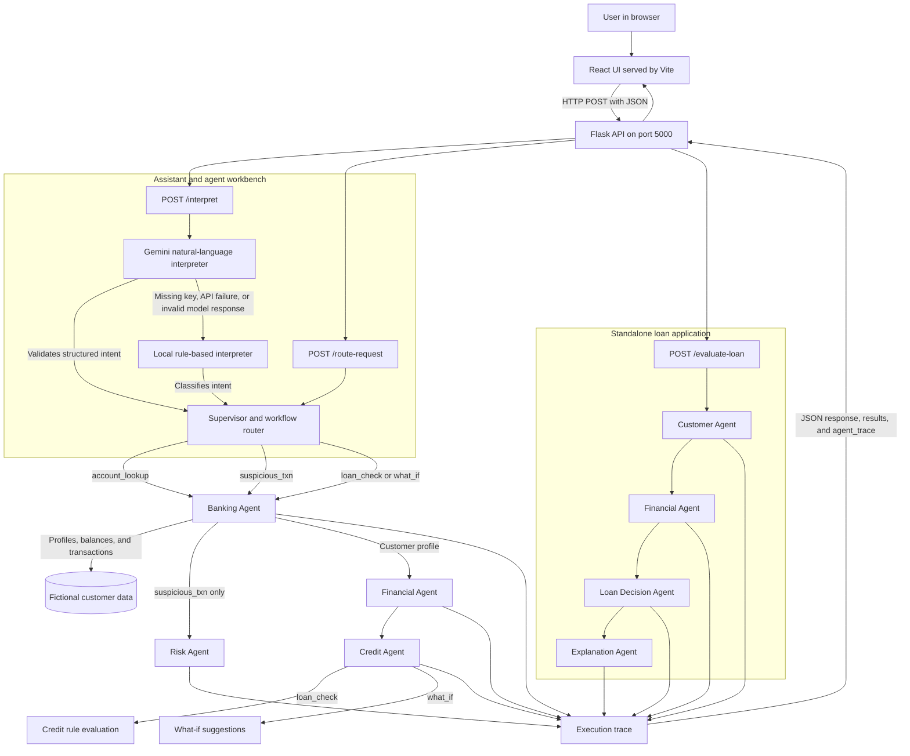

# Architecture

Glass Box Loan Desk is a local, simulated banking application. A React frontend
sends JSON requests to a Flask API. The API runs one of several agent workflows
against fictional customer data and returns both the result and an execution
trace. It does not connect to a real bank, store customer records, or make real
lending decisions.

## System diagram

## Request flows

### Natural-language assistant

1. The frontend posts the user's message to `/interpret`.
2. The interpreter asks Gemini to extract a supported workflow, customer ID,
   and (for loan workflows) loan amount. The response is validated before use.
3. If Gemini is unavailable or returns an unusable result, the API uses the
   local rule-based interpreter. This fallback needs no API key.
4. If required information is missing or the request is unsupported, the API
   returns a clarification instead of running a workflow.
5. Otherwise, the supervisor selects agents for the interpreted workflow.

### Agent workbench

The workbench submits a structured `request_type` directly to
`/route-request`, bypassing natural-language interpretation. The supervisor
validates the workflow and the backend runs the matching agents.

### Loan application

The loan application form submits applicant-provided details to
`/evaluate-loan`. This route does not use the supervisor or Gemini. Its pipeline
validates the applicant, calculates financial ratios, applies the prototype's
decision rules, and formats an explanation.

## Workflow and agent responsibilities

| Workflow | Agent sequence | Result |
|---|---|---|
| `account_lookup` | Banking | Fictional customer profile and account balance |
| `suspicious_txn` | Banking → Risk | Recent fictional transactions and rule-based risk findings |
| `loan_check` via assistant/workbench | Banking → Financial → Credit | Financial ratios and a rule-based credit evaluation |
| `what_if` | Banking → Financial → Credit | Financial ratios and suggestions for improving the current assessment |
| Standalone loan application | Customer → Financial → Loan Decision → Explanation | Validation, financial ratios, prototype decision, and explanation |

The similarly named **Credit Agent** and **Loan Decision Agent** appear in
different flows: assistant/workbench loan checks use the Credit Agent, while the
standalone loan application uses the Loan Decision and Explanation Agents.

## Transparency and data

`run_with_trace` wraps agent calls. For each call it records the agent and tool
names, input, output or error, status, and elapsed time in milliseconds. The API
returns these entries as `agent_trace` for the UI to display. The customer and
account tools read fixed fictional data in the backend; there is no database or
live banking connection.

Gemini is optional and is used only to interpret natural-language requests. It
does not decide loan eligibility. The ratios, risk findings, and loan outcomes
are outputs of the application's prototype rules and must not be treated as
financial advice or real financial decisions.
